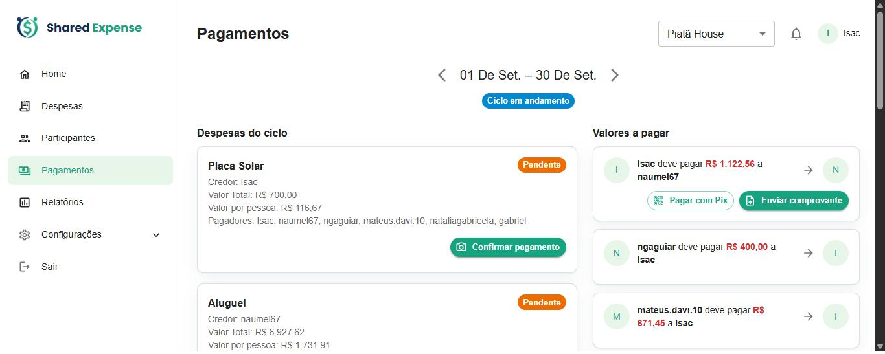
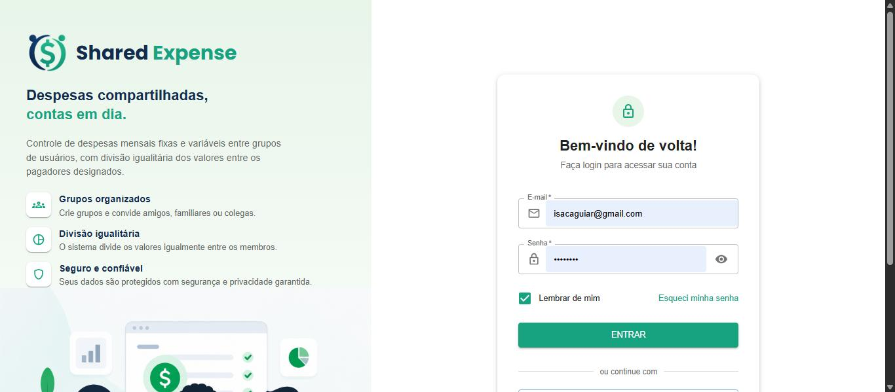
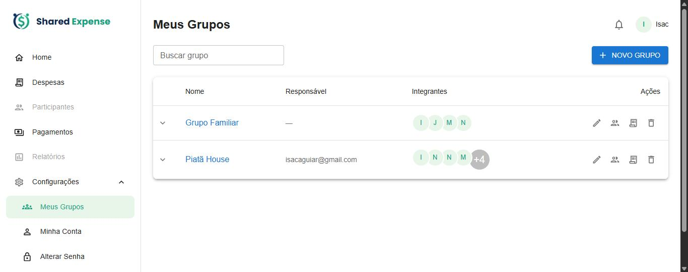
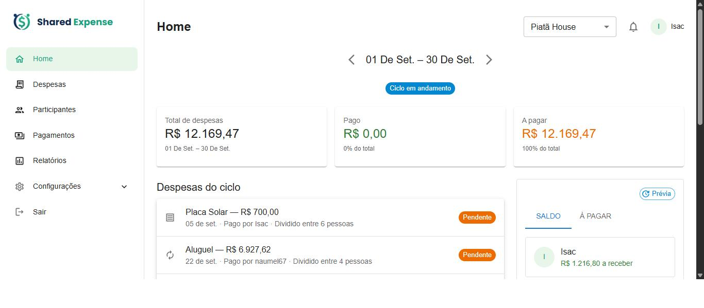
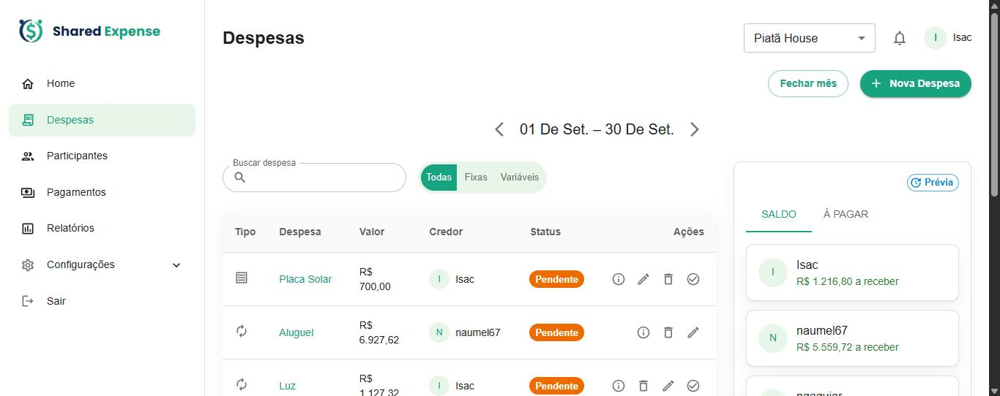
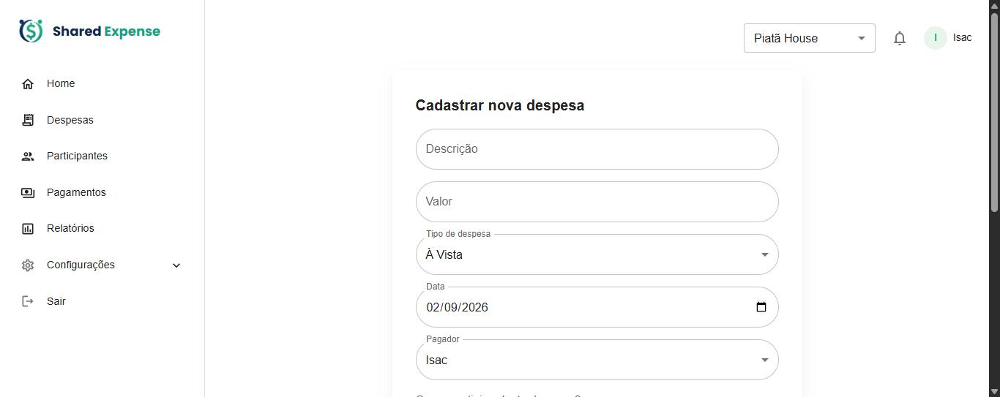
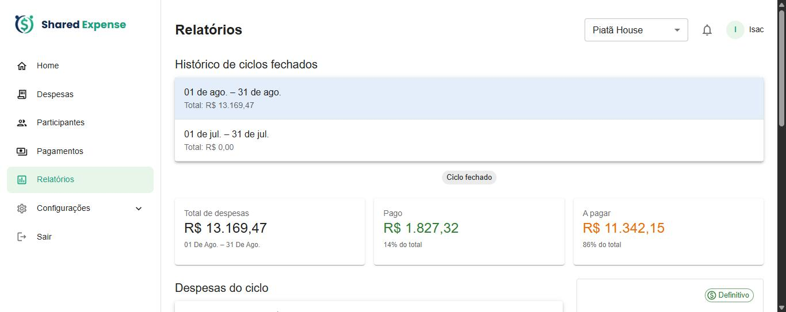

# Manual do Usuário — Controle de Despesas Compartilhadas

## O que é

Aplicativo web para um grupo de pessoas (família, república, amigos) registrar
despesas em comum e dividir os valores. Em vez de cada um pagar cada um, **o app
calcula automaticamente o menor número de transferências que acerta todas as
contas do ciclo** — ninguém faz um Pix que poderia ser evitado. Você acompanha,
mês a mês, quem deve quanto a quem, e paga/cobra por Pix dentro do próprio app.

## Como a conta é calculada

- Cada despesa é dividida **igualmente** entre os participantes que você marcar
  (não precisam ser todos do grupo). Ex.: R$ 120 entre 3 pessoas = R$ 40 cada.
- Ao longo do ciclo, o app soma tudo e calcula o **saldo líquido** de cada
  pessoa: quanto ela tem *a receber* ou *a pagar*.
- A partir dos saldos, ele monta a **liquidação mínima**: o menor conjunto de
  transferências que zera todos os saldos de uma vez.
- **Exemplo:** o Isac pagou R$ 90 de uma conta dividida entre 3. Em vez de dois
  acertos separados, o app mostra apenas: *ngaguiar → Isac R$ 30* e
  *mateus.davi.10 → Isac R$ 30*. Dois Pix, não seis.

*Cada linha de "Valores a pagar" é uma transferência única já calculada pelo app:
"Fulano deve pagar R$ X a Beltrano".*

## Telas principais

### Login

Informe e-mail e senha e clique em **Entrar**. Novos usuários entram por convite:
ao ser adicionado a um grupo, você recebe um e-mail com um link para criar a
senha e ativar a conta.

### Meus Grupos

Ponto de partida. Lista os grupos de que você participa, com o responsável e os
integrantes. **Novo Grupo** cria um grupo (informe nome, descrição e, se quiser,
um "dia de fechamento"). Clique no nome do grupo para abrir a Home dele.

### Home (resumo do grupo)

Visão do ciclo selecionado (use as setas **‹ ›** para trocar de período):
**Total de despesas**, **Pago** e **A pagar**, a lista de despesas e, à direita,
o painel com duas abas — **Saldo** (líquido de cada pessoa) e **À pagar** (a
liquidação mínima). O selo *Prévia* indica que os números ainda mudam até o ciclo
fechar.

### Despesas

Todas as despesas do ciclo, com **Tipo**, **Valor**, **Credor** (quem pagou) e
**Status** (Paga / Pendente). Dá para buscar, filtrar por **Fixas/Variáveis**,
editar, excluir e **marcar como paga**. Ao clicar em **marcar como paga** (o ✓ da
linha), abre um popup: anexe uma **foto do comprovante**, escreva uma **descrição**
do pagamento (por exemplo "pago em dinheiro" ou "Pix agendado", até 500
caracteres) ou os dois. É preciso informar pelo menos um deles para confirmar.
A descrição aparece nos **detalhes** da despesa.

Depois de paga, o credor ainda pode corrigir o comprovante sem desfazer o
pagamento: o ícone do **clipe** (**Editar comprovante**, ao lado de **Desfazer
pagamento**) abre o mesmo popup, já com a foto e a descrição atuais. Dá para
**trocar a foto**, **remover a foto** ou **ajustar a descrição**, e também anexar
a primeira foto a uma despesa que foi paga sem comprovante. A despesa continua
paga, com a mesma data; só é preciso que sobre a foto ou a descrição. Quando o
ciclo está totalmente quitado (todas as despesas pagas e todos os acertos
confirmados), ele vira histórico: o ícone deixa de aparecer e, para corrigir, é
preciso **desfazer o pagamento** e marcá-lo como pago de novo.

**Fechar mês** congela os números do período.

### Nova despesa

Preencha **Descrição**, **Valor**, **Tipo** (À Vista, Parcelada ou Fixa), a
**Data** e o **Pagador** (quem pagou de fato). Em **"Quem participa desta
despesa?"** marque só as pessoas que entram nessa divisão — o valor é rateado
igualmente entre elas.

### Pagamentos

Onde as contas são acertadas. Em **Despesas do ciclo**, o credor confirma o
pagamento no mesmo popup da tela Despesas: foto do comprovante, descrição ou os
dois. Depois de paga, o cartão da despesa ganha o botão **Editar comprovante**,
que faz o mesmo que o ícone da tela Despesas (trocar, remover ou anexar a foto e
ajustar a descrição sem desfazer o pagamento) e também deixa de aparecer quando o
ciclo está totalmente quitado. Em **Valores a pagar**, quem deve usa **Pagar com
Pix** (abre o QR Code / copia-e-cola do credor) e **Enviar comprovante** para
registrar o pagamento; aqui a **foto é obrigatória** e a **descrição é opcional**.
Reenviar o comprovante substitui a foto e a descrição anteriores.

### Relatórios

Histórico dos ciclos já fechados. Clique em um deles para rever os totais, as
despesas e os saldos daquele período — agora com valores **definitivos**.

## Ciclo e tipos de despesa

Um **ciclo** é o período das despesas — o mês calendário ou, se o grupo tiver um
**dia de fechamento**, o intervalo entre um fechamento e o próximo (como a fatura
de um cartão). Quanto ao tipo: **Fixa** repete automaticamente em todo ciclo até
você removê-la (aluguel, internet…); **À Vista** é um lançamento único; e
**Parcelada** divide o valor em N meses. Ao usar **Fechar mês**, os números
daquele ciclo ficam congelados e passam a aparecer em Relatórios.

## Passo a passo

1. **Ative sua conta** pelo link do convite e faça login.
2. Em **Configurações → Minha Conta**, cadastre sua **chave Pix** (para receber).
3. **Crie o grupo** e, em **Participantes**, adicione as pessoas por e-mail.
4. Em **Despesas**, lance os gastos do mês:
   - contas recorrentes → tipo **Fixa** (uma vez só);
   - compras do dia a dia → **À Vista** ou **Parcelada**.
5. Acompanhe na **Home** o saldo de cada um e quem paga a quem.
6. Em **Pagamentos**, o devedor paga por **Pix** e envia o comprovante; o credor
   **confirma** o recebimento.
7. No fim do período, use **Fechar mês** e consulte depois em **Relatórios**.
